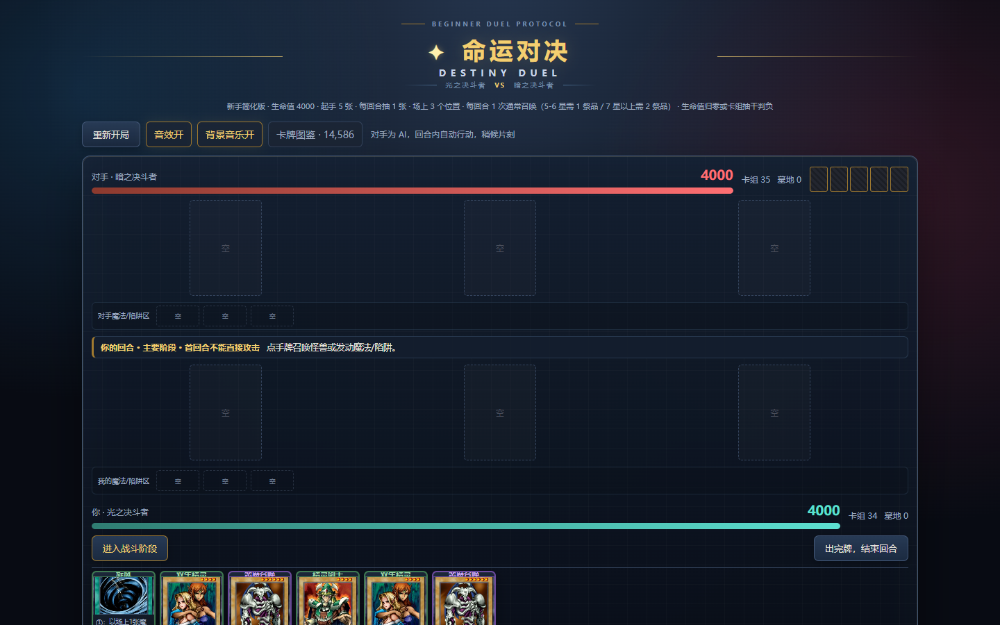
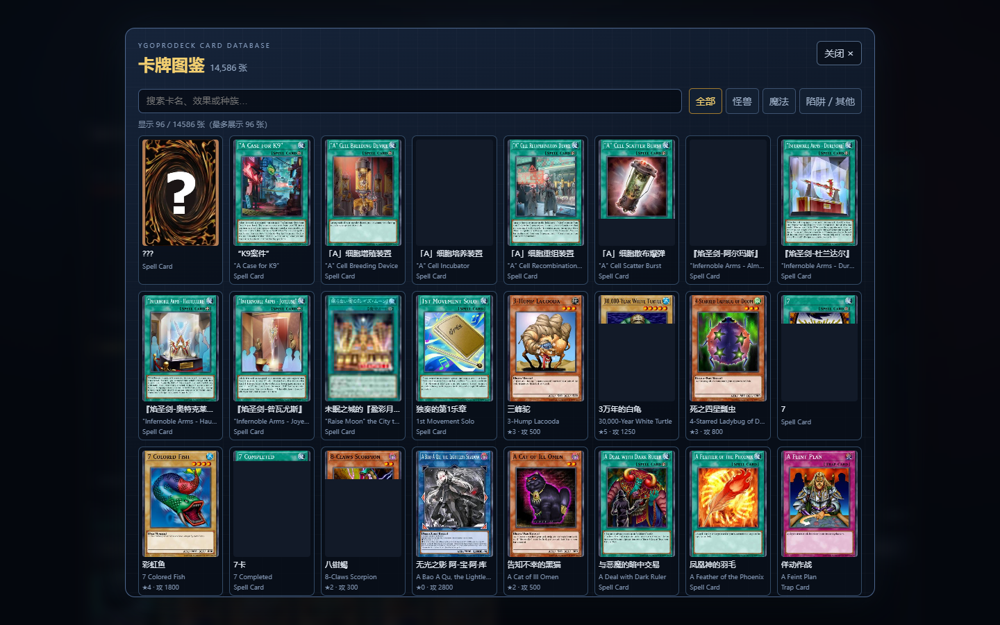

# 命运对决 · Destiny Duel

新手友好的类游戏王卡牌对战，用 [boardgame.io](https://boardgame.io) v0.50.x 实现。
人机对战：你执「光之决斗者」，脚本 AI 执「暗之决斗者」。





## 快速开始

Windows：**双击 `start-game.bat`** 即可自动装依赖、启动并打开浏览器。

```bash
npm install
npm run dev     # http://localhost:5173
npm test        # 44 个测试
npm run build
```

## 规则

| 项 | 设定 |
|---|---|
| 生命值 | 双方各 4000，归零判负 |
| 卡组 | 共用一副 20 张（14 怪兽 + 6 魔法），起手 5 张 |
| 抽牌 | 每回合开始抽 1 张；卡组抽干判负 |
| 场上 | 3 个槽位 |
| 通常召唤 | 每回合 1 次。≤4 星无需祭品，5-6 星需 1 只，7 星以上需 2 只（自动选场上攻击力最低的怪兽作为祭品） |
| 战斗 | 攻击力 > 对方攻击力则破坏守方，伤害 = 攻击力 − 防御力；反之攻击方被反杀；相同则同归于尽 |
| 直接攻击 | 对方场上无怪兽时可直击，伤害 = 攻击力 |
| 特殊 | 死者苏生从墓地召唤不占通常召唤次数；光の护封剑让对手下个回合无法攻击 |
| 胜负 | 生命值归零 或 卡组抽干 |

## 卡牌与版权

14 张怪兽与 5 张魔法的**名称、等级、攻防、属性、种族取自
[ygoprodeck.com](https://ygoprodeck.com/) 公开卡牌数据库**（事实性游戏数据）。
效果描述是为新手重写的口语化版本，与原作效果文本不同。

卡牌插画是 Konami 的版权作品。本项目**不附带、不下载、不分发**任何官方插画。
卡面默认由 CSS 绘制。若你拥有有权使用的图片（例如自己实体卡收藏的扫描件），
按 `public/cards/README.md` 的文件名放进该目录即可自动加载，无需改任何代码；
没有图片时游戏功能完全不受影响。

本项目为非官方 fan project，与 Konami 无关联。

## 放入自己的卡面图

```
public/cards/blueEyes.jpg
public/cards/darkMagician.jpg
...
```

文件存在就用图，不存在自动回落到 CSS 卡面。完整文件名对照见
`public/cards/README.md`。

## 新手操作入口

- 召唤怪兽：点击手牌中的怪兽后，在棋盘状态栏下方选择「攻击表示」或「守备表示」。
- 查看效果：点击顶部「卡牌图鉴 · 14,586」，输入卡名或效果关键词，再点击卡片展开完整资料。
- 图鉴按需加载 `public/data/cards.catalog.json`，不会拖慢对战首屏。

### 交互防回归记录

表示形式选择使用 `pendingSummon` 保存临时状态；仅更新状态栏文字是不够的，必须同时渲染
可点击的攻击/守备按钮，否则新手会看到提示却无法完成召唤。修改召唤流程后，应在真实浏览器
中验证「点击四星怪兽 → 出现两个表示按钮 → 点击攻击表示 → 场上出现怪兽」这条路径。

## 结构

```
src/
├── cards.js    卡池数据 + 祭品规则 + 卡面图路径约定 + 中文显示回退
├── game.js     纯游戏定义（无 React、无网络依赖）
├── hints.js    共享的「这一步能不能做 / 为什么不能」判断
├── board.jsx   棋盘：一键交互、状态反馈、战报、演出
├── bot.js      脚本 AI
├── sfx.js      Web Audio 合成音效（零素材）
├── app.css     深色决斗场视觉
└── index.jsx   入口：Local() + AI 客户端 + 工具栏 + 卡牌图鉴

tests/
├── game.test.js      22 个规则单元测试
├── zh-cards.test.js  中文卡库：命中返回中文、缺失回落英文、starter 全覆盖、覆盖率
└── fullgame.test.js  5 局全自动对局 + 状态不变量
```

## 中文卡库

图鉴的卡名与效果说明接入了中文译名，来源是百鸽
[ygocdb.com](https://ygocdb.com/) 的 `/api/v0/cards.zip`（按 8 位密码 `id`
与 YGOPRODeck 图鉴一一对齐）。

- 数据落地在 `public/data/zh-cards.json`（运行时按需加载，不进 JS 包）。
- 重新生成：`node scripts/import-zh-cards.mjs`（自动下载并解压中文源；
  也可用 `--input 已下载的cards.json` 指定本地源）。
- 显示规则：有中文译名则显示中文，并在卡名下方标注英文原名；
  **没有中文译名的卡（多为 TCG / 动画 / 游戏独有卡）直接回落英文原文，
  绝不把英文冒充中文**。
- 当前覆盖率：图鉴 14,586 张中 **14,238 张（97.6%）** 命中中文卡名与
  效果文本，其余 348 张（2.4%，ygocdb 未收录的 TCG / 动画 / 游戏独有卡）
  回落英文。

## 设计决策

**为什么用 `G.step` 而不是 flow phases**
boardgame.io 的 phase 结峰会**强制结束当前回合**。而这里是「一个回合内含
主要阶段 / 战斗阶段 两个子步骤」，所以用单一隐式阶段 + `G.step` 跟踪子步骤，
在 moves 内做守卫。回合内的子流程一律不用 phases。

**为什么伤害用真实的「攻击力 − 防御力」而不是只比攻击力**
卡牌数据是真实的（青眼白龙 3000/2500、精灵之少女 800/2000）。如果只比
攻击力，防御力就成了摆设，低攻高防的卡没有存在价值。用原作公式后，
精灵之少女 800/2000 成为天然铁壁——要用 2900 以上攻击力才能击破，且要付出
伤害代价。这是规则深度，不是复杂度。

**为什么 `castSpell` 设 `client: false`**
抽牌魔法会摸到隐藏卡组。框架在客户端和服务端各跑一遍 move，允许客户端乐观
执行会让两端状态分叉，也会泄露隐藏信息。

**为什么演出事件存在 `G` 里而不是组件内做状态 diff**
「攻击者被反杀」时攻击者卡片随攻击一起从状态消失，基于 diff 的检测会整个
漏掉这次攻击（弹窗与战报静默丢失）。把结构化事件写进 `G`，动画引擎消费
`G.fx`，没有这个盲区，且能随状态一起回放。

**为什么 AI 与 UI 共用 `hints.js`**
`INVALID_MOVE` 是静默的。如果 UI 和 move 各自判断合法性，必然出现「UI 说
能做但 move 拒绝」的不一致。共用一份判断后，状态行给出的理由与实际规则同源。

**魔法/陷阱区与墓地流转**

双方各有 3 个简化魔法/陷阱槽位。一次性效果成功结算后，卡牌从手牌移入墓地；
持续效果（当前由光之护封剑示范）留在场上，持续到对手受影响的回合结束后再进墓地。
持续区没有空位时会在界面提示，且不会消耗手牌。新手牌组固定 40 张，每种卡最多 3 张。
目前牌组里的陷阱卡为空；陷阱的盖放与连锁时机不在当前简化规则内。

## 踩过的坑

### 调试面板会拦截真实点击，而且关不掉

**现象**：`index.jsx` 里已经写了 `debug: false`，但调试面板照样出现在页面上，
浮在棋盘上方挡住卡牌。

**根因**：调试面板不是由 React 组件渲染的，而是由 `Local()` 的 master 挂到
`document.body` 上的。看 `boardgame.io/dist/esm/client-*.js` 的 `mountDebug()`：
门槛是 `client.debugOpt === false`。master 会检查**所有**已注册的客户端，
只要有任何一个没显式关掉，面板就会挂载。人类客户端关了没用——`bot.js` 里
创建的 AI 客户端没传 `debug`，走默认值，于是面板被挂上了。

**修法**：`createBotClient` 里也传 `debug: false`，并且在 `<App>` 上显式传
`debug={false}` prop（组件 `defaultProps.debug` 是 `true`，不传 prop 会被补上）。

**检查方法**：改完后断言 `document.querySelector('.bgio-debug')` 为 null，
别只看肉眼截图。

### Node 24 的 `node --test` 不接受目录参数

`node --test tests/` 报 `MODULE_NOT_FOUND`。改成不带参数让它自动发现。

### `client.start()` 会触发 `turn.onBegin`

写规则单元测试时用 `Client({...})` + `start()` 构造指定状态，`onBegin` 会
抽 1 张牌，污染手牌断言。单元测试里把 `onBegin` 打桩成空函数，回合钩子本身
另写测试覆盖。

### 单测全绿 ≠ 浏览器能玩

`game.js` 的所有 move 在 Node 测试里都通过，但浏览器里的 `Local()` 传输层
可能静默丢弃 move。唯一可靠的验证是在真实浏览器里走完
召唤 → 战斗 → 攻击 → 结束回合 → AI 行动 → 分出胜负的完整循环。

## 测试覆盖

44 个测试：

- 中文卡库（8 个）：命中中文返回中文、缺失回落英文且不伪造、starter 14 张
  全部命中且与权威库一致、覆盖率阈值、buildTranslation 匹配/不伪造/去重
- 召唤与祭品：4 星免祭品、7 星需 2 祭品（不足时拒绝、齐备时成功且祭品入墓）、
  每回合限 1 次、不能召唤魔法卡
- 魔法：抽 2 / 抽 3 / 破坏对方最强（无目标时拒绝）/ 死者苏生不占召唤次数 /
  无怪兽时拒绝 / 护封剑锁定下回合
- 战斗：攻击表示攻对攻、守备表示攻对防、攻低被反杀、同攻同归于尽、
  对方有怪兽时禁直击、空场可直击、同一只每回合限 1 次、主要阶段不能攻击
- 新手规则：每位玩家的第一个回合不能直接攻击，点击「出完牌，结束回合」后解除限制
- 胜负：生命归零、卡组抽干
- 秘密状态：playerView 隐藏对手手牌与双方卡组
- 回合钩子：回合开始抽 1 张并重置标记
- 整局：5 个种子各自自动打完并分出胜负；场上怪兽数不超槽位；战报累积且有上限

整局测试用与 AI 完全相同的决策函数（`decideNextAction` + `applyAction`）驱动
双方，走与 UI 完全一致的 `client.moves.*` 接口。
